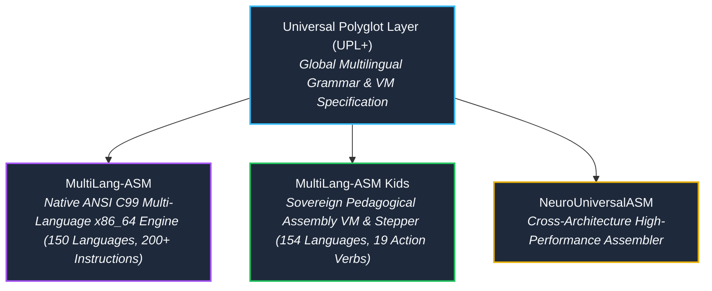

# 📜 Genealogy of the Neuro-ASM Ecosystem & UPL Standards

The **MultiLang-ASM Kids** initiative is part of the broader **Neuro-OS** and **Universal Polyglot Layer (UPL)** ecosystem.

---

## 🏛️ Ecosystem Lineage

1. **[Universal Polyglot Layer (UPL)](https://github.com/cyberenigma-lgtm/UNIVERSAL-POLYGLOT-LAYER-UPL):**
   The formal architectural foundation for sovereign, multi-language computation across all natural human tongues without English bias.
2. **[MultiLang-ASM](https://github.com/cyberenigma-lgtm/MultiLang-ASM):**
   The core technical assembly engine, supporting 150 languages, 200+ canonical instructions, and bidirectional translation to NASM and GNU Assembler.
3. **[MultiLang-ASM Kids](https://github.com/cyberenigma-lgtm/MultiLang-ASM-Kids):**
   The dedicated pedagogical engine designed for schools, teachers, young students, and self-taught coders. Built in 100% ANSI C99 with an integrated interactive stepper virtual machine.
4. **[NeuroUniversalASM](https://github.com/cyberenigma-lgtm/NeuroUniversalASM):**
   The multi-target backend uniting x86_64, ARM64, and RISC-V under unified polyglot assembly semantics.
