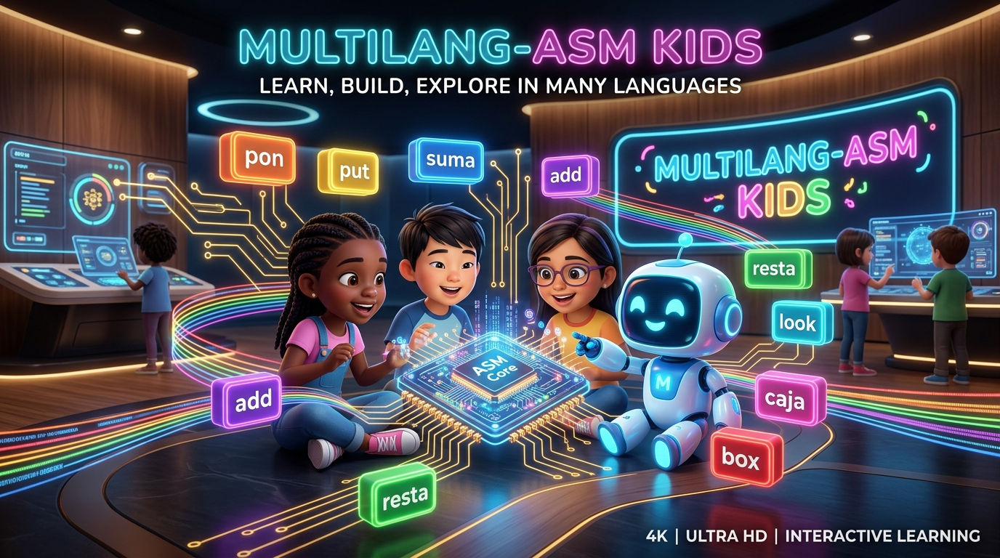

# 🧸 MultiLang-ASM Kids Wiki

Welcome to the official documentation and knowledge base for **MultiLang-ASM Kids**, the sovereign educational branch of the **Universal Polyglot Layer (UPL+)** and **MultiLang-ASM**.

MultiLang-ASM Kids teaches children, teenagers, and students worldwide (ages 5 to 18) the foundational logic of computer architecture and assembly language—in their **mother tongue**, using friendly natural action verbs instead of intimidating cryptic abbreviations.

---

## 📚 Table of Contents

1. **[Curriculum & Learning Stages](Curriculum)**
   - Detailed pedagogical roadmap from Level 1 to Level 5.
2. **[Instruction & Verb Reference](Reference)**
   - Complete breakdown of all 19 action verbs and magic boxes.
3. **[Teacher's Classroom Guide](Teachers_Guide)**
   - Classroom setups, unplugged activities, and interactive demonstrations.
4. **[Global Examples Library (154 Languages)](Examples)**
   - First steps programs across all 154 supported world languages.
5. **[Troubleshooting & Tips](Troubleshooting)**
   - How to solve common questions and terminal issues.
6. **[Genealogy & Architecture](Genealogy)**
   - Historical lineage within Neuro-OS and UPL+ standards.

---

## 🚀 Key Highlights

- **154 World Languages & Dialects:** True native parity across Europe, Asia, Africa, Americas, and Oceania.
- **100% ANSI C99 Native Engine:** 0% Python runtime dependency. Single portable binary (`mlasm_kids.exe` / `mlasm_kids`).
- **Interactive Stepper VM:** Run programs step-by-step with visual feedback (`mlasm_kids run file.kasm --step`) without installing NASM or external toolchains.
- **NASM Transpiler:** Transpile directly into 64-bit machine assembly (`mlasm_kids compile file.kasm -o file.asm`).
- **Open Source & Sovereign:** Free software for schools, parents, and educators worldwide.
